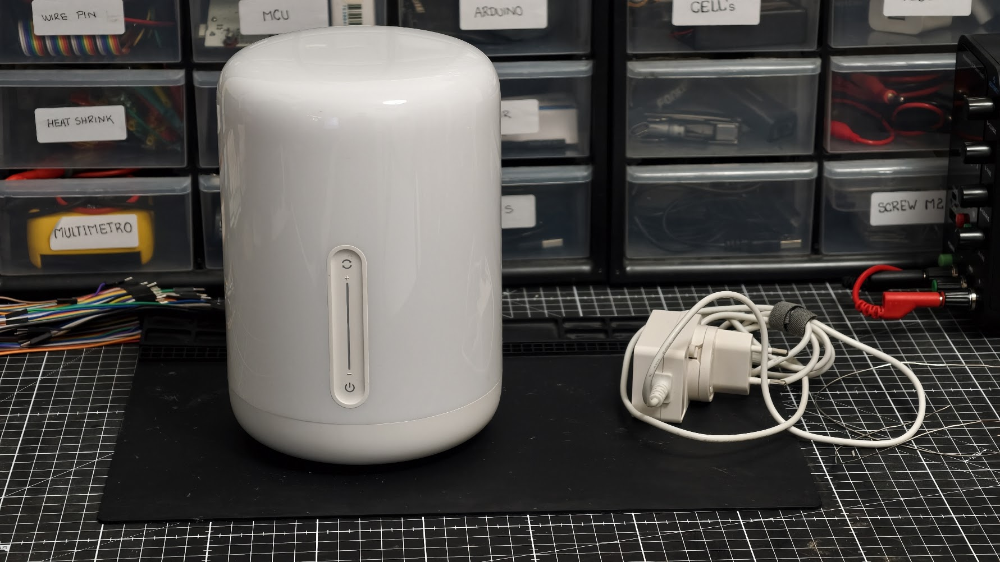
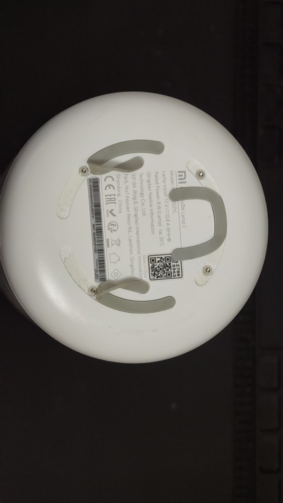
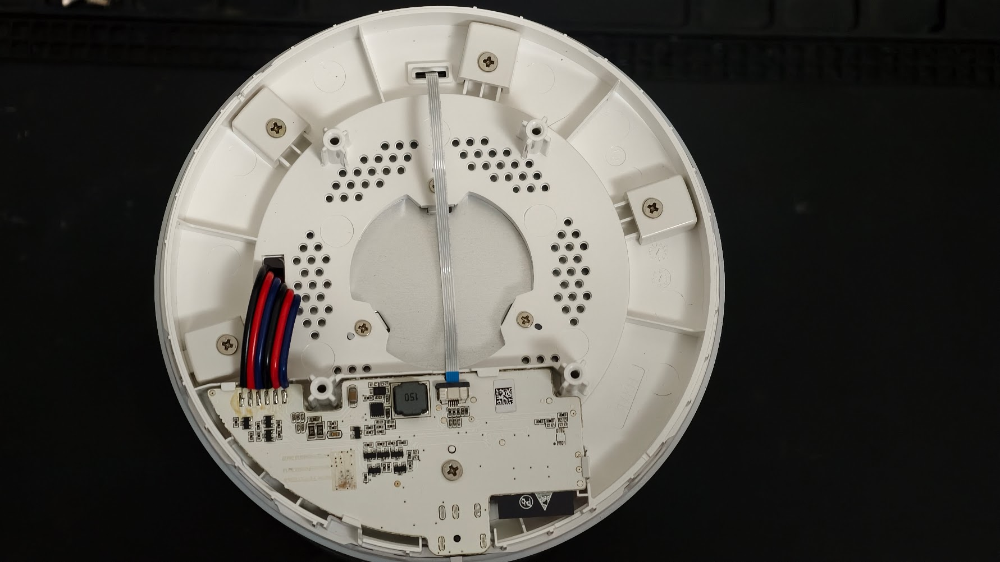
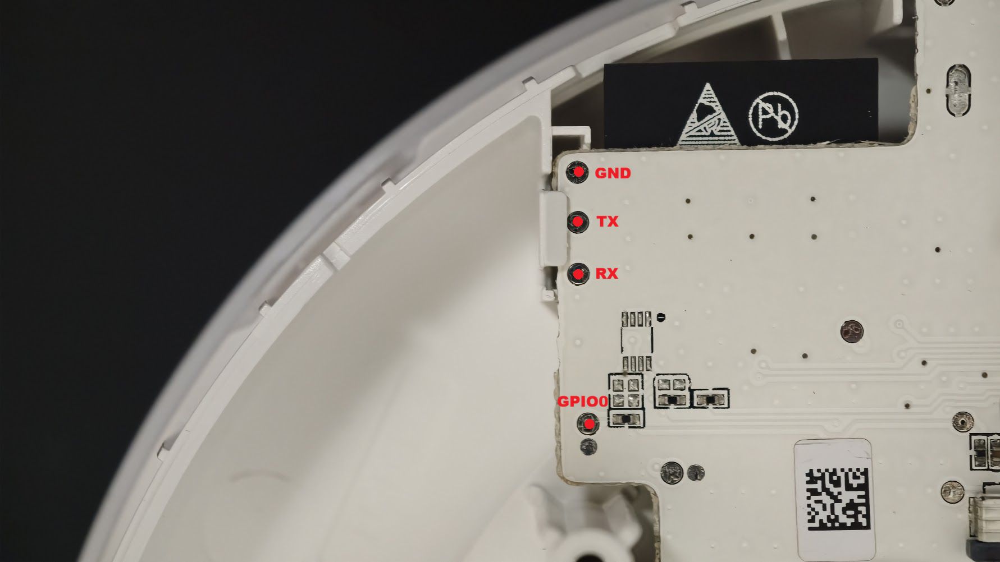
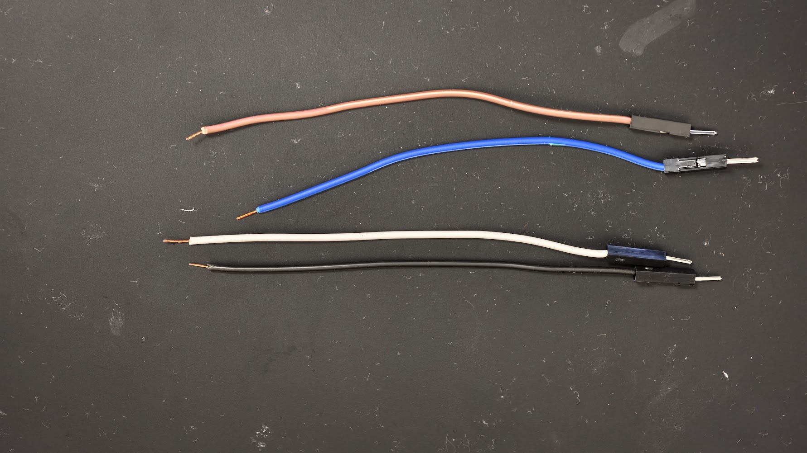
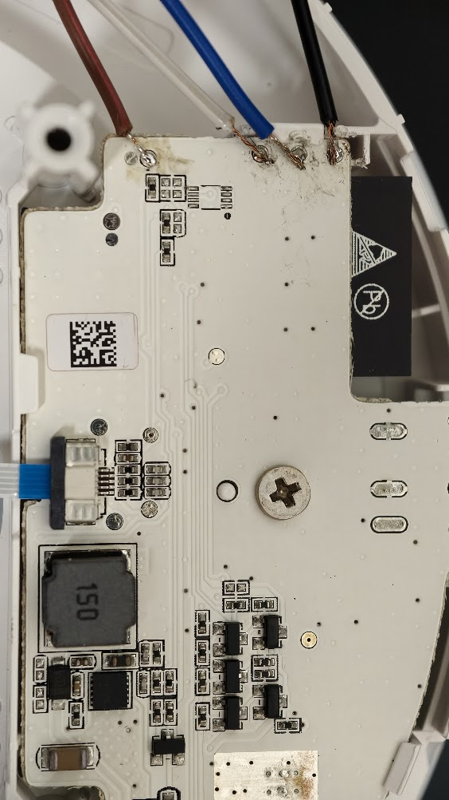
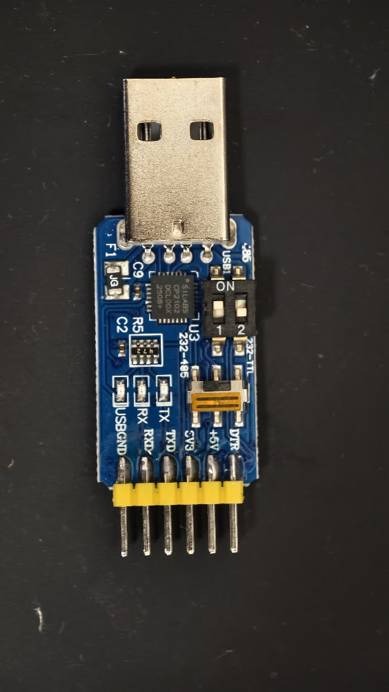
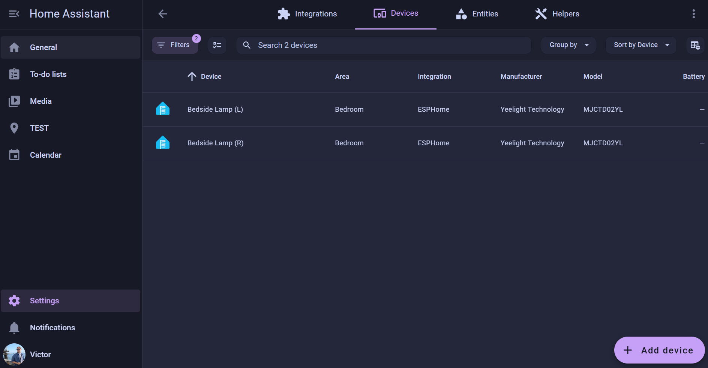

I have two Xiaomi Mi Bedside Lamp 2 in my bedroom, one on each side of the bed. They are nice
lamps, but with the original firmware they only work through the Xiaomi app and the Xiaomi cloud.
If the cloud or my internet is down, I can't control them. And I don't really like a lamp in my
bedroom talking all the time to a server I don't control.

Some years ago you could enable "LAN control" and add the lamp to Home Assistant with the Yeelight
integration, but Xiaomi removed this option with a firmware update in 2021. So I wanted my lamps to work only locally with Home Assistant, like the rest of my house.

The good news is that there is an ESP32 inside the lamp, so you can replace the firmware with
[ESPHome](https://esphome.io). The hardware is not trivial (the LED driving, the touch panel on
the front, a single core ESP32 with a wrong checksum in its eFuses...), but mmakaay already did
all the reverse engineering in the
[esphome-xiaomi_bslamp2](https://github.com/mmakaay/esphome-xiaomi_bslamp2) project. Everything works like with the original firmware: RGB and white light, the night light, and the buttons and slider on the front, which you can also use in your Home Assistant
automations. And the lamp doesn't talk to the Xiaomi cloud anymore.

In this post I write all the steps I did, including the things that went wrong, because for the
first lamp not everything worked on first try. The second lamp took me maybe 30 minutes.

My setup is a desktop with NixOS, but except the Nix parts the steps are the same on any Linux.




## What you need

- The lamp (model MJCTD02YL)
- A USB to serial adapter that can do **3.3V**. I used a cheap CP2102 board
- A USB cable **that can transfer data**
- Soldering iron and wires (I used dupont wires and cut one end)
- T8 torx to open the lamp


## Step 1: Get the project and the tools

First clone the repository:

```
git clone https://github.com/mmakaay/esphome-xiaomi_bslamp2.git
cd esphome-xiaomi_bslamp2
```

The project needs ESPHome 2026.10.0 or newer, and the stable NixOS channel was too old for this.
So I made a small `flake.nix` with a dev shell that takes `esphome` and `esptool` from
nixpkgs-unstable:

```nix
{
  inputs.nixpkgs.url = "github:NixOS/nixpkgs/nixpkgs-unstable";

  outputs = { nixpkgs, ... }:
    let
      systems = [ "x86_64-linux" "aarch64-linux" "x86_64-darwin" "aarch64-darwin" ];
      forAllSystems = f: nixpkgs.lib.genAttrs systems (system: f nixpkgs.legacyPackages.${system});
    in {
      devShells = forAllSystems (pkgs: {
        default = pkgs.mkShell {
          packages = [ pkgs.esphome pkgs.esptool ];
        };
      });
    };
}
```

Then just enter the shell:

```
$ nix develop
ESPHome 2026.11.0, esptool 5.6.0
```

If you are not on NixOS, you can install ESPHome and esptool with `pip` or your package manager.


## Step 2: Write the configuration

I made a folder `my-lamp/` inside the repo for my own files.

First let's create the `my-lamp/secrets.yaml`:

```yaml
# Only 2.4 GHz networks work, the lamp has no 5 GHz
wifi_ssid: "MyWifi"
wifi_password: "changeme"

# You need api_encryption_key later for Home Assistant
api_encryption_key: "<output of: openssl rand -base64 32>"
ota_password: "<some random password>"
```

Then the config of the lamp. I simply copied `example.yaml` from the repo and changed only the name and the package version. This is `my-lamp/bedside-lamp-left.yaml` (without the comments):

```yaml
substitutions:
  name: bedside-lamp-left
  friendly_name: Bedside Lamp (L)

packages:
  bslamp2:
    url: https://github.com/mmakaay/esphome-xiaomi_bslamp2
    ref: release/2026.10.0
    files:
      - packages/core.yaml
      - packages/behavior_default.yaml
      - packages/night_light_calibration.yaml
      - packages/ota_feedback.yaml
      - packages/activate_preset_svc.yaml
    refresh: 0s

wifi:
  ssid: !secret wifi_ssid
  password: !secret wifi_password

api:
  encryption:
    key: !secret api_encryption_key

ota:
  platform: esphome
  password: !secret ota_password
```

For the other lamp I have the same file with `bedside-lamp-right` and `Bedside Lamp (R)`, and both
use the same secrets.

If you have more than one lamp, you don't need left/right names. I only did it to know which one
is which in HA and in the network. If you prefer one file for all your lamps, add `name_add_mac_suffix: true` under `esphome:` and ESPHome adds a part of the MAC address to the name.

**Tip:** if you use separate files, don't call both `bedside-lamp.yaml` like I did. I overwrote the config of my first lamp with the second one and had to write it again.


## Step 3: Validate and compile

Now check the config is OK:

```
$ esphome config ./my-lamp/bedside-lamp-left.yaml
INFO ESPHome 2026.11.0
INFO Reading configuration my-lamp/bedside-lamp-left.yaml...
INFO Updating https://github.com/mmakaay/esphome-xiaomi_bslamp2@release/2026.10.0
WARNING 'ota' password wastes significant flash and RAM; using 'encryption' instead is recommended
...
INFO Configuration is valid!
```

Then compile it. The first time takes a few minutes because it downloads the ESP-IDF framework:

```
$ esphome compile ./my-lamp/bedside-lamp-left.yaml
...
RAM:   [===       ]  25.3% (used 45708 bytes from 180736 bytes)
Flash: [====      ]  43.4% (used 795573 bytes from 1835008 bytes)
INFO Creating factory.bin...
INFO Created: .../my-lamp/.esphome/build/bedside-lamp-left/build/firmware.factory.bin
INFO Created: .../my-lamp/.esphome/build/bedside-lamp-left/build/firmware.ota.bin
INFO Successfully compiled program.
```

The firmware is ready. Now let's move to the hardware part.


## Step 4: Open the lamp

Remove the rubber pads in the bottom of the lamp. You don't need to remove them completely, only
enough to see the 4 screws below.



Unscrew the 4 screws and pull off the bottom. It needs a bit of force, just go slowly around until
it comes loose. Then you will directly see the exposed PCB where we will connect.




## Step 5: Solder the wires

On the board there are small debug pads. You need 4 of them: `RX`, `TX`, `GND` and `GPIO0`.



I cut dupont wires on one side, removed a bit of the plastic, put some solder on the wire and then
soldered them to the pads. Don't use too much solder on `GPIO0`, the pad next to it is very close
and if you connect both the lamp always stays in flash mode.



Also **don't use the 3.3V pad** to power the board from the adapter. The lamp must always use its
own power supply.



If you want to keep the wires for later, a bit of hot glue helps so they don't break off.


## Step 6: Connect the adapter

First check that your adapter is set to **3.3V** (mine has a small jumper for 3.3V / 5V). Then
connect like this:

| Lamp pad | Adapter pin |
|----------|-------------|
| GND      | GND         |
| TX       | RX          |
| RX       | TX          |
| GPIO0    | GND         |

Yes, TX goes to RX and RX goes to TX. This is normal.

`GPIO0` must be connected to GND **when the lamp starts**, this puts the ESP32 in flash mode. My
adapter has only one GND pin, so I used a breadboard to connect the two GND wires together.



Keep the lamp power supply **unplugged** for now.


## Step 7: Serial port permissions on NixOS

On Linux the serial port `/dev/ttyUSB0` belongs to the `dialout` group, so your user needs to be
in it. On NixOS add this to your config and rebuild:

```nix
users.users.shunya.extraGroups = [ "dialout" ];
```

The new group only applies after you log in again. I didn't want to log out, so I used
`newgrp dialout` in my terminal:

```
$ id
uid=1000(shunya) gid=100(users) groups=100(users),1(wheel),57(networkmanager)

$ newgrp dialout

$ id
uid=1000(shunya) gid=27(dialout) groups=27(dialout),1(wheel),57(networkmanager),100(users)
```

Now `dialout` is there.


## Step 8: Check the adapter is detected

Plug the adapter into USB and check:

```
$ ls /dev/serial/by-id/
usb-Silicon_Labs_CP2102_USB_to_UART_Bridge_Controller_0001-if00-port0

$ lsusb
...
Bus 001 Device 018: ID 10c4:ea60 Silicon Labs CP210x UART Bridge
...
```

## Step 9: Put the lamp in flash mode and test the connection

With `GPIO0` still on GND, now plug in the lamp power supply. The lamp stays dark, this is OK, it is
waiting in flash mode. It stays like this until you unplug the power, so you have time.

Then test that esptool can talk with the chip:

```
$ esptool -p /dev/ttyUSB0 chip-id
esptool v5.6.0
Connected to ESP32 on /dev/ttyUSB0:
Chip type:          Unknown ESP32 (revision v1.0)
Features:           Wi-Fi, BT, Single Core + LP Core, 240MHz, Vref calibration in eFuse, Coding Scheme 3/4
Crystal frequency:  40MHz
MAC:                68:ab:bc:xx:xx:xx

Stub flasher running.

WARNING: ESP32 has no chip ID. Reading MAC address instead.
MAC:                68:ab:bc:xx:xx:xx

Hard resetting via RTS pin...
```

`Connected to ESP32` is what you want to see. The "Unknown ESP32" and the chip ID warning are
normal for this lamp.

If you only see `Connecting.........` forever, look at the troubleshooting part at the end.


## Step 10: Back up the original firmware

This is optional, but I recommend it. If one day you want the Xiaomi firmware back, you need this
file:

```
$ esptool -p /dev/ttyUSB0 read-flash 0x0 0x400000 original-firmware-left.bin
esptool v5.6.0
Connected to ESP32 on /dev/ttyUSB0:
...
Read 4194304 bytes from 0x00000000 in 385.6 seconds (87.0 kbit/s) to 'original-firmware-left.bin'.

Hard resetting via RTS pin...
```

It takes around 6 minutes. You will see the progress, just wait until it finishes.


## Step 11: Flash ESPHome

Now the exciting moment:

```
$ esphome upload ./my-lamp/bedside-lamp-left.yaml --device /dev/ttyUSB0
INFO ESPHome 2026.11.0
INFO Loaded validated config cache for bedside-lamp-left.yaml, skipping validation.
esptool v5.6.0
Connected to ESP32 on /dev/ttyUSB0:
Chip type:          Unknown ESP32 (revision v1.0)
...
WARNING: Detected crystal freq 79.95 MHz is quite different to normalized freq 48 MHz. Unsupported crystal in use?
...
Changing baud rate to 460800...
Changed.

Configuring flash size...
Auto-detected flash size: 4MB
Flash will be erased from 0x00000000 to 0x000d2fff...
Wrote 861232 bytes (563323 compressed) at 0x00000000 in 13.9 seconds (494.2 kbit/s).
Hash of data verified.

Hard resetting via RTS pin...
INFO Successfully uploaded program.
```

Only 14 seconds! The message `Hash of data verified` means the firmware is written correctly.

## Step 12: First boot with ESPHome

Unplug the lamp power, **remove the GPIO0 wire from GND**, and plug the power again. If you forget
to remove GPIO0, the lamp starts again in flash mode and nothing happens.

Now the lamp should connect to your Wi-Fi. You can check with the logs over the network:

```
$ esphome logs ./my-lamp/bedside-lamp-left.yaml --device OTA
INFO ESPHome 2026.11.0
INFO Starting log output from bedside-lamp-left.local using esphome API
INFO Successfully resolved bedside-lamp-left.local in 0.091s
INFO Successfully connected to bedside-lamp-left @ 192.168.30.231 in 0.131s
INFO Successful handshake with bedside-lamp-left @ 192.168.30.231 in 0.895s
[21:27:04.275][W][esp-idf:000]: E (37382) system_api: Base MAC address from BLK0 of EFUSE CRC error, efuse_crc = 0xbb; calc_crc = 0x7e
[21:27:04.276][W][app:188]: Set flash_chip: generic under esp32 > framework > advanced to save IRAM
[21:27:04.276][W][app:227]: Bootloader supports SRAM1 as IRAM (+40KB). Set sram1_as_iram: true under esp32 > framework > advanced
```

It works! The three warnings are not a problem:

- The `EFUSE CRC error` happens on all these lamps, Xiaomi wrote a wrong checksum in the chip. The
  project already handles this (`ignore_efuse_mac_crc: true` in `core.yaml`).
- The other two are only tips to save some memory.

Write down the IP address, you may need it for Home Assistant.

Now you can put the wires away (or remove them) and close the lamp. From now on, updates go over
Wi-Fi:

```
$ esphome run ./my-lamp/bedside-lamp-left.yaml --device OTA
```


## Step 13: Add it to Home Assistant

In Home Assistant the lamp normally shows up by itself as a newly discovered ESPHome device in **Settings → Devices & services** if you have the ESPHome integration. Click it, and when it asks, give the `api_encryption_key` from your `secrets.yaml`. If it doesn't appear, simply go to **Settings → Devices & services → Integrations**, navigate to the ESPHome integration (or add it if it's not there!) and select **Add Device**, then you can introduce the corresponding IP address that you copied in Step 12 and the api key as well.



## Troubleshooting (things that happened to me)

### esptool shows only `Connecting.........` forever

With my first lamp this was the big problem. To understand what was going on, I listened on the
serial port while plugging in the lamp power:

```
$ stty -F /dev/ttyUSB0 115200 raw -echo && cat /dev/ttyUSB0
ets Jun  8 2016 00:22:57

rst:0x1 (POWERON_RESET),boot:0x2 (DOWNLOAD_BOOT(UART0/UART1/SDIO_REI_FEO_V2))
waiting for download
```

This tells you a lot:

- **You see nothing at all:** nothing from the lamp TX reaches the adapter. Check TX/RX are not
  swapped, the GND is connected, and the solder joints are good.
- **You see `SPI_FAST_FLASH_BOOT`:** GPIO0 was not on GND when the lamp started.
- **You see `DOWNLOAD_BOOT` and `waiting for download`** (like me): the lamp is in flash mode and
  the adapter receives, but the computer can't send to the lamp. Check the wire from the adapter
  TX to the lamp RX pad.

In my case I first had nothing at all, then after checking the wires I got `waiting for download`
but esptool still did not connect. I checked all wires again, plugged the lamp power **first**
and only then started the command, and this time it worked. I'm still not 100% sure which of the
two fixed it.

### `Failed to connect to ESP32: No serial data received`

`esphome upload` only tries for a few seconds and then gives up with this error. Because the lamp
stays in flash mode until you unplug it, it is easier to plug the lamp power first and then
start the command.


## How to go back to the original firmware

If one day you want the Xiaomi firmware back, connect the wires again (with GPIO0 on GND), plug
the power and write the backup:

```
$ esptool --chip esp32 -p /dev/ttyUSB0 -b 115200 write-flash 0x0 original-firmware-left.bin
```

Then unplug, remove GPIO0 from GND, and power on again.


## Final words

Now both lamps run ESPHome, work completely locally, and I can use them in my Home Assistant
automations. The first lamp gave me some headache, but the second one was really easy once
everything was clear.
